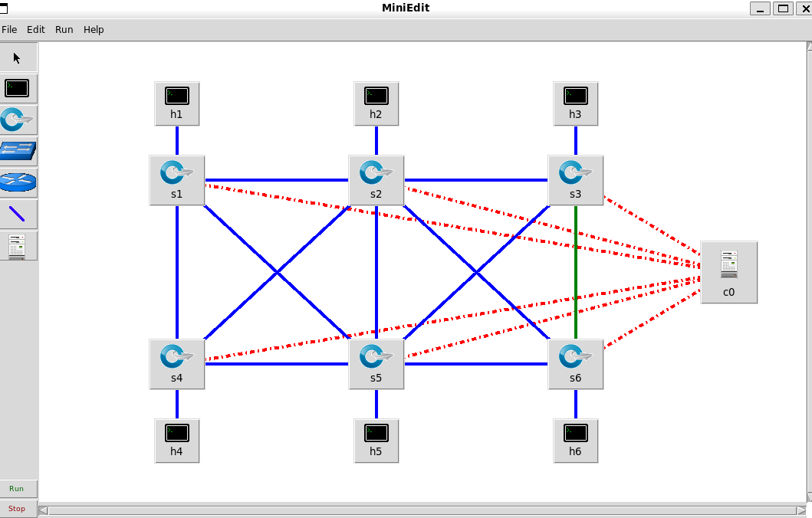
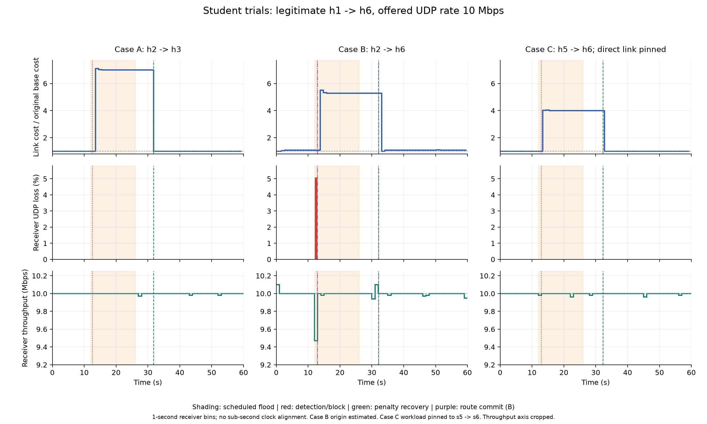
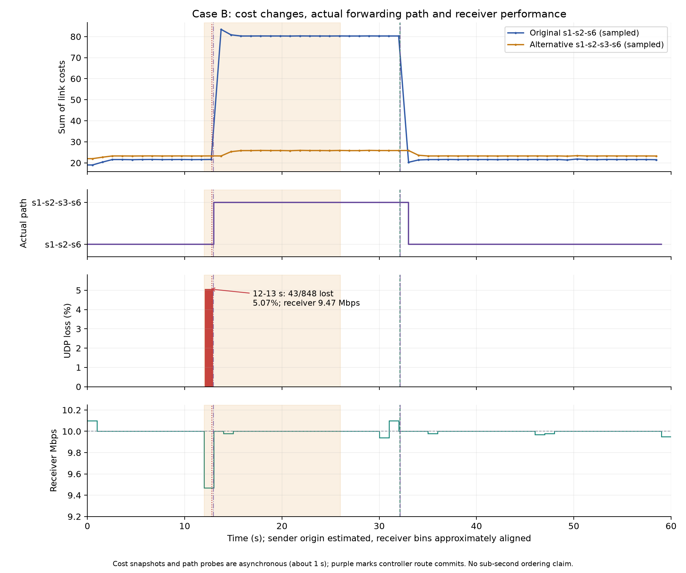
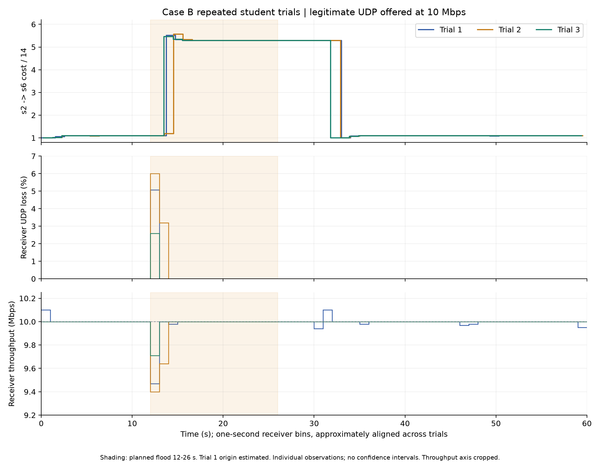

# Task5 性能评价与三轮重复测量

学生实验显示，在10Mbps合法UDP提供负载下，集成控制器能检测并封锁异常源、提高受影响链路代价、在需要时切换合法路线，并在异常停止后恢复代价和路线。A/C的合法路线保持不变；B的三次独立测量均由1→2→6改为1→2→3→6再恢复。B在异常启动附近出现短暂性能扰动，稳定阶段接收恢复接近10Mbps。

本材料包含A/C各一次和B三次学生真实测量，共五轮。所有结果均保留，不选择最好的一轮代表全部，也不混入助手独立验收数据。完整作业报告仍需整合其他任务、课程要求的AI声明，以及C实验条件的说明和助教确认。

## 拓扑与实验参数

网络包含6台主机、6台OpenFlow交换机、1个远程控制器；6条主机链路与11条交换机链路，链路带宽40Mbps。截图来自学生原图并验证SHA256一致。主机固定IP/MAC与接入端口，交换机链路由LLDP发现，代理ARP避免网状广播环路。

每轮合法流为h1→h6 UDP，提供负载10,000,000bit/s、持续60秒。约第12秒启动14秒ICMP flood，A为h2→h3、B为h2→h6、C为h5→h6。各轮重新启动控制器与网络状态，避免上一轮源封锁影响下一轮。

源入口累计计数按实际时间差分得到pps，EMA系数0.3、阈值倍数3、最低2000pps、至少5个有效样本预热。按旧EMA判断异常；异常源IPv4在全部交换机安装priority5000 drop。源入口drop计数继续用于判断异常活动。

链路代价为C=C0+5U+60A，容量40Mbps，U由对端入口字节计数计算。异常惩罚至少保持8秒，且drop连续5秒无活动才恢复；源IP封锁保留。Dijkstra按有向动态代价选路；新路至少便宜1且距离上次切换至少3秒才更新。内部VLAN路由版本先准备下游、Barrier确认后切入口，旧版本保留5秒后按cookie删除。

C条件必须披露：仅h5→h6 IPv4测试对显式固定经过直接5→6，以对指定链路施压；原基础代价不变。教师原图的自然最短路是5→3→6，基础成本16，直接5→6成本20。该设置是否满足教学安排仍需向助教确认。

## 指标与时间口径

归一化使用C(t)/C0，A/B/C目标链路分母分别10、14、20。归一化值1表示等于基础代价，不是利用率100%。相同绝对惩罚60对应约7、5.29、4的不同平台，不能据倍数高低直接比较攻击强弱。

UDP丢包率为100×接收端lost/total；吞吐取接收端iperf报告的Mbps。曲线保留60个一秒窗口，没有平滑；整轮汇总取最终报告，结束尾部边界与一秒窗口可能略有不同。Mbps有原始显示舍入，不声称超出输入精度的精确测量。

浅色区域表示计划约12–26秒异常窗口，检测/封锁事件与代价恢复标记来自控制器记录。A/C及B第2/3轮保存发送进程启动时间，B第1轮零点由采样估计。接收窗口起点是第一份UDP数据到达，控制器事件与接收曲线仅按约一秒级对齐。停止边界是计划timeout，不是独立记录的精确退出瞬间。

## 三场景时间曲线

图中B使用第1轮，下面的重复测量图另列三轮，避免把单个场景曲线误认为三轮均值。吞吐纵轴裁至9.2–10.25Mbps以显示小变化。

|场景|整轮接收Mbps|整轮UDP丢包|合法路线行为|
|---|---:|---:|---|
|A|10.0|0/51024，0%|保持1→2→6|
|B第1轮|9.99|43/51024，约0.0843%|改到1→2→3→6，再恢复|
|C|10.0|0/51024，0%|保持1→2→6|

A的2→3代价约10→70→10；C的5→6代价约20→80→20。h1→h6原路线均未经过对应异常边，因此保持原路合理。封锁后受影响链路到达速率接近0，但源入口drop仍增加，惩罚继续保持；安静期满足后恢复。

## B的路径选择与性能

正常稳定段原路线成本约21.57、替代路线约23.28；异常稳定段原路线约80.35、替代路线约25.80，因此控制器切换到替代路线。恢复段原路线约21.58、替代路线约23.29，合法流返回原路。基础成本19不含负载项，应与动态成本区分。

路径由实际入口标签、下游规则、输出端口、Linux接口peer及递增包计数确认。成本快照、路径探测和事件时间是异步的，图中小于约一秒的相对位置不作为精确因果先后证据。

## B三轮重复观测

|轮次|整轮接收Mbps|整轮丢包/总数|整轮UDP丢包率|最高一秒丢包率|最低一秒Mbps|
|---|---:|---:|---:|---:|---:|
|1|9.99|43/51024|0.0843%|5.0708%|9.47|
|2|9.99|78/51024|0.1529%|6.0000%|9.40|
|3|10.0|22/51024|0.0431%|2.5943%|9.71|

三轮均完成检测封锁、必要改道和恢复，全部一秒接收窗口都有流量。第1轮全部43包丢失发生于12–13秒；第2轮12–13秒丢51包、13–14秒丢27包；第3轮12–13秒丢22包。稳定接收阶段回到接近10Mbps。

三轮整轮丢包率均值约0.0934%，样本标准差约0.0554个百分点，范围0.0431%–0.1529%。合计143/153072个UDP数据报丢失，合并比例约0.0934%。这些是三次观测的描述统计，不提供长期可靠性保证或置信区间。

同样的flood命令没有固定发送pps，实际生成速率、轮询相位、CPU调度和队列状态可能波动。当前数据不能分离每个丢包的原因，也不能将轮间差异归因于单一因素。接收吞吐采用原始舍入值，不计算虚假精度的吞吐标准差。

## 异常前中后稳定窗口

|实验|前4–10秒Mbps|中15–24秒Mbps|后40–55秒Mbps|三个窗口UDP丢包|
|---|---:|---:|---:|---|
|A|10.000|10.000|9.997|均0%|
|B第1轮|10.000|10.000|9.997|均0%|
|B第2轮|10.000|10.000|10.000|均0%|
|B第3轮|10.000|10.000|10.000|均0%|
|C|10.000|9.996|9.997|均0%|

这些选定窗口避开了12–14秒过渡段，不能用其零丢包否认曲线中的瞬时峰值。Task5同时呈现整轮、稳定段和逐秒观测，避免只用总体平均值掩盖短暂扰动。

## 封锁、恢复与结束探测

源封锁与路由规则使用不同cookie。全部实际流表快照确认源drop在改道、恢复及旧版本清理时保留，后续合法ping成功，异常源ping被阻断。三组及补测的原始证据均另有离线核验PASS。

脚本在60秒测量结束后对已封锁源再发两个ping，验证封锁仍有效。当前策略将已封锁源的新活动重新激活短期惩罚，故控制器末尾可能再出现一次改道及恢复。第3轮的这次重激活约发生在62.63秒，已排除于0–60秒性能图之外，不计作正式异常再次开始；截图作为补充证据保留。

持续ping原始统计均保留，结束时未收到最后序号的情况与清理终止时的在途尾包相容，但没有抓包证明。Task5丢包曲线使用UDP接收计数，ICMP原始统计单列，不互相替换。

## 结论范围与后续报告

本组数据支持在10Mbps合法UDP提供负载下，集成控制器能保护合法连接、隔离异常源，并按动态成本切换和恢复路径；B三轮均有异常启动邻近的短暂丢包，幅度存在波动。

没有禁用改道但保持检测/封锁不变的对照，因此不能量化改道相对于仅封锁的独立收益；没有测试40Mbps饱和吞吐或证明参数最优。A/C各一轮、B三轮，不能把B的重复性推广成所有场景的统计保证。C固定测试流条件仍须披露并确认。

Task5测量、三类图和分析材料已完成，当前计划无需继续增加重复轮次。下一步把本章节与拓扑搭建、基础控制器和异常检测实现等章节整合成完整作业报告，并按课程要求声明AI辅助范围。

## 数据来源

原三场景汇总保留在initial-scenario-analysis.json；B三轮数值与冻结输入哈希见B-repeat-summary.json、B-repeat-statistics.json。冻结输入副本位于上级B-repeats-20261017-three-trials-final/inputs，未修改原始日志。B第1轮原始收尾FAIL保留，其缺ryu.log的检查错误已查明，完整测量经另存原始数据核验PASS；第2/3轮直接输出PASS。

CSV提供每秒数值，SVG供报告排版；复制产物的来源与SHA256记录在copied-artifacts-provenance.json，最终目录另有artifact-manifest.json和FINAL_VALIDATION.json。前期版本和失败记录全部保留，没有用后来的较好结果替换早期观测。
